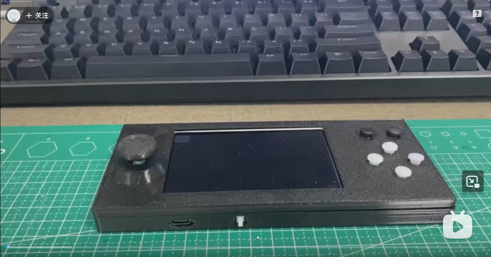

> ⚠️ **学习项目 / Learning Project**
> 
> 这是复刻 DIJI-NES 的项目，进行了部分调整。  
> 

   

自2026年5月至10月，共五个月的时间，从学习复刻，到调整功能最终实现成品组装，在此做个回忆记录，有兴趣的可以自取。   

调整内容  
1.屏幕拉伸（240*256拉伸至320*480横向4寸大屏，ST7796）   
2.菜单汉化   
3.方向键改为摇杆   
4.菜单左右键翻页，上下键选择   

备忘：   
1.显示屏焊接40P 0.5MM引脚需要用白色焊油，黄色焊膏会短路   
2.显示屏ST7796转接板有8位16位并口切换电路，对照电路图调整，即断开R4、短接R5使IM0=1完成模式选择   

显示屏引脚（ST7796  4寸并口8位  320*480）
wr   = 2;          
rs   = 1;          
d0   = 41;       
d1   = 40;        
d2   = 39;      
d3   = 45;        
d4   = 47;        
d5   = 21;       
d6   = 20;          
d7   = 19; 
rst  = 42;

声音模块引脚（MAX98357）   
I2S_BCLK_PIN 16   
I2S_LRCLK_PIN 17   
I2S_DATA_PIN 15   

TF卡读写模块引脚    
CS_PIN     14    
SCLK_PIN   13    
MISO_PIN   11   
MOSI_PIN   12   

按键引脚   
A_BUTTON      6   
B_BUTTON      4   
X_BUTTON      7   
Y_BUTTON      5   
START_BUTTON  3   
SELECT_BUTTON 8   

摇杆引脚   
JOYSTICK_X_PIN    9//1   // 摇杆 X 轴（左右）   
JOYSTICK_Y_PIN   10//2   // 摇杆 Y 轴（上下）  

汉化菜单（void setup()中添加 ）     
tft.setFont(&fonts::efontCN_16_b);  // 设置简体中文字库  追加代码    

屏幕拉伸显示（240*256位伸至320*480）   
static void display_task(void* arg) {   
    uint8_t buf_idx;   
    const int TARGET_W = 480;  
    const int TARGET_H = 320;  
    
    // 预计算水平映射表（256 -> 480）   
    static uint16_t x_map[480];  
    static bool map_initialized = false;  
    if (!map_initialized) {  
        for (int x = 0; x < TARGET_W; x++) {   
            x_map[x] = (x * SCREEN_WIDTH) / TARGET_W;  //原屏幕旋转自动拉伸，可能是320自动拉伸到480，与256进行还原到全屏  
        }  
        map_initialized = true;  
    }  
    
    // 预计算垂直映射表（240 -> 320）   
    static uint16_t y_map[320];   
    static bool y_map_initialized = false;   
    if (!y_map_initialized) {   
        for (int y = 0; y < TARGET_H; y++) {   
            y_map[y] = (y * SCREEN_HEIGHT) / TARGET_H;   
        }   
        y_map_initialized = true;   
    }   
    
    // 分配行缓冲区   
    uint16_t* lineBuffer = (uint16_t*)heap_caps_malloc(TARGET_W * sizeof(uint16_t), MALLOC_CAP_DMA);    
    if (!lineBuffer) {   
        static uint16_t staticBuffer[480];   
        lineBuffer = staticBuffer;   
    }   
       
    for (;;) {   
        if (xQueueReceive(frame_queue, &buf_idx, portMAX_DELAY) != pdTRUE)   
            continue;   
        
        uint32_t t0 = micros();   
        uint16_t* buf = frame_buf[buf_idx];   
        
        tft.startWrite();   
        
        for (int y = 0; y < TARGET_H; y++) {   
            uint16_t* srcLine = buf + y_map[y] * SCREEN_WIDTH;   
            
            for (int x = 0; x < TARGET_W; x++) {   
                lineBuffer[x] = srcLine[x_map[x]];   
            }  
            
            tft.setAddrWindow(0, y, TARGET_W, 1);    
            tft.pushPixelsDMA(lineBuffer, TARGET_W);   
            tft.waitDMA();   
        }   
        
        tft.endWrite();   
        last_displayed_idx = buf_idx;   
        last_dma_us = micros() - t0;   
        vTaskDelay(pdMS_TO_TICKS(1));   
    }   
}   